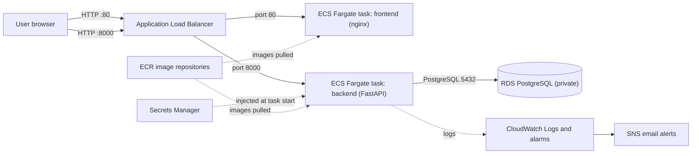

# AWS Deployment Guide

This guide documents how the Healthcare DevSecOps Risk Assessment Framework is deployed on AWS. It describes the deployment that was actually built and tested, in region **ap-southeast-2 (Sydney)**.

- **Primary deployment:** containers on **ECS Fargate** behind an **Application Load Balancer**, with data in **Amazon RDS for PostgreSQL**.
- **Fallback deployment:** the same three containers on a single **EC2** instance with Docker Compose (see section 9).

All commands can be run from **AWS CloudShell** (a terminal in the browser), so nothing has to be installed locally. Replace `<ACCOUNT_ID>` with your 12-digit AWS account ID.

> The project still runs fully on a developer machine with `docker compose up`. AWS is only needed for the live cloud deployment.

---

## 1. Architecture



- Port **80** on the load balancer forwards to the frontend container; port **8000** forwards to the backend container.
- The browser calls the backend directly on port 8000. The frontend is built with the backend address baked in (`VITE_API_URL`), so the frontend image must be rebuilt if the load balancer address ever changes.
- The database is **not reachable from the internet**. Only the backend tasks (and, for administration, the EC2 build server) may connect to it.

## 2. Resource inventory

| Resource | Name | Notes |
|---|---|---|
| ECS cluster | `healthsec-cluster` | Fargate |
| ECS services | `healthsec-backend`, `healthsec-frontend` | 1 task each |
| Backend task | 0.5 vCPU, 2 GB | FastAPI, ML and SHAP libraries need the memory |
| Frontend task | 0.25 vCPU, 0.5 GB | nginx serving the React build |
| Load balancer | `healthsec-alb` | Listeners 80 and 8000; target groups `healthsec-fe-tg`, `healthsec-be-tg` |
| Database | `healthsec-db` | RDS PostgreSQL 18.3, `db.t3.micro`, 20 GB, single-AZ, not public, 1-day automated backups |
| Image registry | ECR `healthsec-backend`, `healthsec-frontend` | |
| Secrets | `healthsec/rds-database-url`, `healthsec/jwt-secret-key`, `healthsec/demo-password` | Secrets Manager |
| IAM roles | `healthsec-ecs-exec-role`, `healthsec-ec2-role` | See section 3 |
| Security groups | `healthsec-alb-sg`, `healthsec-ecs-sg`, `healthsec-rds-sg` | See section 3 |
| Logs | CloudWatch log group `/ecs/healthsec` | 14-day retention |
| Alarms | `healthsec-backend-unhealthy`, `healthsec-db-high-cpu`, EC2 status-check alarm | Notify SNS topic `healthsec-alerts` |
| Audit | CloudTrail trail `healthsec-trail` | Logs to an S3 bucket |
| Backups | S3 bucket `healthsec-backup-<ACCOUNT_ID>` (prefix `db/`) | Manual `pg_dump` copies |
| Cost control | AWS Budget `healthsec-monthly` | Email alerts |
| Build and fallback server | EC2 `healthsec` (Ubuntu 24.04, t3.small), Elastic IP, EBS snapshot | |

## 3. Security model

**Layered network access (security groups):**

| Group | Inbound |
|---|---|
| `healthsec-alb-sg` | TCP 80 and 8000 from the internet |
| `healthsec-ecs-sg` | TCP 80 and 8000 **only from** `healthsec-alb-sg` |
| `healthsec-rds-sg` | TCP 5432 **only from** `healthsec-ecs-sg` and the EC2 server's security group |

Traffic can only flow internet → load balancer → containers → database. The Fargate tasks have public IP addresses (needed to pull images without a NAT gateway), but their security group refuses everything that does not come from the load balancer.

**Secrets:** database URL, JWT signing key and demo password live in Secrets Manager and are injected into the backend container at start-up. They are not in the image, the task definition text, or the repository.

**Least-privilege IAM:**
- `healthsec-ecs-exec-role` can pull images, write logs and read secrets named `healthsec/*`.
- `healthsec-ec2-role` (on the build server) can push to ECR, read the `healthsec/*` secrets and write to the backup bucket only.

**Audit and alerting:** CloudTrail records account activity; CloudWatch alarms email on failures.

**Known gap:** traffic is plain HTTP (no domain or certificate). See section 11.

## 4. Deployment procedure

### 4.0 Variables

```bash
export AWS_REGION=ap-southeast-2 AWS_DEFAULT_REGION=ap-southeast-2 AWS_PAGER=""
ACCOUNT_ID=$(aws sts get-caller-identity --query Account --output text)
```

### 4.1 Network and security groups

```bash
VPC_ID=$(aws ec2 describe-vpcs --filters Name=isDefault,Values=true --query 'Vpcs[0].VpcId' --output text)
SUBNETS=$(aws ec2 describe-subnets --filters Name=vpc-id,Values=$VPC_ID --query 'Subnets[*].SubnetId' --output text)
SUBNET1=$(echo $SUBNETS | awk '{print $1}'); SUBNET2=$(echo $SUBNETS | awk '{print $2}')
EC2_SG=<security group ID of the EC2 build server>

ALB_SG=$(aws ec2 create-security-group --group-name healthsec-alb-sg --description "healthsec ALB" --vpc-id $VPC_ID --query GroupId --output text)
aws ec2 authorize-security-group-ingress --group-id $ALB_SG --protocol tcp --port 80 --cidr 0.0.0.0/0
aws ec2 authorize-security-group-ingress --group-id $ALB_SG --protocol tcp --port 8000 --cidr 0.0.0.0/0

ECS_SG=$(aws ec2 create-security-group --group-name healthsec-ecs-sg --description "healthsec ECS tasks" --vpc-id $VPC_ID --query GroupId --output text)
aws ec2 authorize-security-group-ingress --group-id $ECS_SG --protocol tcp --port 80 --source-group $ALB_SG
aws ec2 authorize-security-group-ingress --group-id $ECS_SG --protocol tcp --port 8000 --source-group $ALB_SG

RDS_SG=$(aws ec2 create-security-group --group-name healthsec-rds-sg --description "healthsec RDS" --vpc-id $VPC_ID --query GroupId --output text)
aws ec2 authorize-security-group-ingress --group-id $RDS_SG --protocol tcp --port 5432 --source-group $ECS_SG
aws ec2 authorize-security-group-ingress --group-id $RDS_SG --protocol tcp --port 5432 --source-group $EC2_SG
```

### 4.2 Database (RDS)

```bash
DB_PASSWORD=$(openssl rand -hex 16)
aws rds create-db-instance --db-instance-identifier healthsec-db --db-instance-class db.t3.micro \
  --engine postgres --allocated-storage 20 --master-username healthsec_user --master-user-password "$DB_PASSWORD" \
  --db-name healthsec_db --vpc-security-group-ids $RDS_SG --no-publicly-accessible \
  --backup-retention-period 1 --no-multi-az
aws rds wait db-instance-available --db-instance-identifier healthsec-db
DB_HOST=$(aws rds describe-db-instances --db-instance-identifier healthsec-db --query 'DBInstances[0].Endpoint.Address' --output text)
```

### 4.3 Secrets

```bash
JWT_SECRET=$(openssl rand -hex 32)
DB_SECRET_ARN=$(aws secretsmanager create-secret --name healthsec/rds-database-url --secret-string "postgresql://healthsec_user:${DB_PASSWORD}@${DB_HOST}:5432/healthsec_db" --query ARN --output text)
JWT_SECRET_ARN=$(aws secretsmanager create-secret --name healthsec/jwt-secret-key --secret-string "$JWT_SECRET" --query ARN --output text)
DEMO_SECRET_ARN=$(aws secretsmanager create-secret --name healthsec/demo-password --secret-string '<choose a strong demo password>' --query ARN --output text)
```

### 4.4 Load balancer, target groups and listeners

```bash
ALB_ARN=$(aws elbv2 create-load-balancer --name healthsec-alb --subnets $SUBNET1 $SUBNET2 --security-groups $ALB_SG --query 'LoadBalancers[0].LoadBalancerArn' --output text)
ALB_DNS=$(aws elbv2 describe-load-balancers --load-balancer-arns $ALB_ARN --query 'LoadBalancers[0].DNSName' --output text)

FE_TG_ARN=$(aws elbv2 create-target-group --name healthsec-fe-tg --protocol HTTP --port 80 --vpc-id $VPC_ID --target-type ip --health-check-path / --query 'TargetGroups[0].TargetGroupArn' --output text)
BE_TG_ARN=$(aws elbv2 create-target-group --name healthsec-be-tg --protocol HTTP --port 8000 --vpc-id $VPC_ID --target-type ip --health-check-path /health --query 'TargetGroups[0].TargetGroupArn' --output text)

aws elbv2 create-listener --load-balancer-arn $ALB_ARN --protocol HTTP --port 80   --default-actions Type=forward,TargetGroupArn=$FE_TG_ARN
aws elbv2 create-listener --load-balancer-arn $ALB_ARN --protocol HTTP --port 8000 --default-actions Type=forward,TargetGroupArn=$BE_TG_ARN
```

### 4.5 ECS execution role

```bash
aws iam create-role --role-name healthsec-ecs-exec-role --assume-role-policy-document '{"Version":"2012-10-17","Statement":[{"Effect":"Allow","Principal":{"Service":"ecs-tasks.amazonaws.com"},"Action":"sts:AssumeRole"}]}'
aws iam attach-role-policy --role-name healthsec-ecs-exec-role --policy-arn arn:aws:iam::aws:policy/service-role/AmazonECSTaskExecutionRolePolicy

cat > secrets-policy.json <<EOF
{"Version":"2012-10-17","Statement":[{"Effect":"Allow","Action":"secretsmanager:GetSecretValue","Resource":"arn:aws:secretsmanager:$AWS_REGION:$ACCOUNT_ID:secret:healthsec/*"}]}
EOF
aws iam put-role-policy --role-name healthsec-ecs-exec-role --policy-name read-healthsec-secrets --policy-document file://secrets-policy.json
ECS_EXEC_ROLE_ARN=$(aws iam get-role --role-name healthsec-ecs-exec-role --query Role.Arn --output text)
```

### 4.6 Build and push the images

Run on any Linux host that has Docker and the AWS CLI and an IAM role allowed to push to ECR (in this project, the EC2 `healthsec` server with `healthsec-ec2-role`).

```bash
aws ecr create-repository --repository-name healthsec-backend
aws ecr create-repository --repository-name healthsec-frontend

ECR=<ACCOUNT_ID>.dkr.ecr.ap-southeast-2.amazonaws.com
aws ecr get-login-password | sudo docker login --username AWS --password-stdin $ECR

sudo docker build -t $ECR/healthsec-backend:latest ./backend
sudo docker push $ECR/healthsec-backend:latest

# The frontend must be built with the load balancer address:
sudo docker build --provenance=false -f frontend/Dockerfile.prod \
  --build-arg VITE_API_URL=http://<ALB_DNS>:8000 -t $ECR/healthsec-frontend:latest ./frontend
sudo docker push $ECR/healthsec-frontend:latest
```

### 4.7 Migrating the existing database into RDS

Do this **before** starting the backend service. If the backend starts against an empty database it creates its own tables, and the restore would then conflict with them.

```bash
# On the EC2 server (it may reach RDS through the security group):
DBURL=$(aws secretsmanager get-secret-value --secret-id healthsec/rds-database-url --query SecretString --output text)

docker compose -f docker-compose.ec2.yml exec -T db pg_dump -U healthsec_user -d healthsec_db --no-owner --no-privileges > dump.sql
sudo docker run --rm -i postgres:18 psql "$DBURL" < dump.sql

# Verify:
sudo docker run --rm postgres:18 psql "$DBURL" -c "select username from users;" -c "select count(*) from scans;"
rm dump.sql
```

### 4.8 ECS cluster, task definitions and services

```bash
aws logs create-log-group --log-group-name /ecs/healthsec
aws logs put-retention-policy --log-group-name /ecs/healthsec --retention-in-days 14
aws ecs create-cluster --cluster-name healthsec-cluster
```

Backend task definition (`taskdef-backend.json`):

```bash
cat > taskdef-backend.json <<EOF
{
  "family": "healthsec-backend",
  "networkMode": "awsvpc",
  "requiresCompatibilities": ["FARGATE"],
  "cpu": "512",
  "memory": "2048",
  "executionRoleArn": "$ECS_EXEC_ROLE_ARN",
  "containerDefinitions": [{
    "name": "backend",
    "image": "$ACCOUNT_ID.dkr.ecr.$AWS_REGION.amazonaws.com/healthsec-backend:latest",
    "essential": true,
    "portMappings": [{"containerPort": 8000}],
    "environment": [
      {"name": "APP_ENV", "value": "production"},
      {"name": "JWT_ALGORITHM", "value": "HS256"},
      {"name": "ACCESS_TOKEN_EXPIRE_MINUTES", "value": "60"},
      {"name": "DEMO_USERNAME", "value": "demo_doctor"},
      {"name": "CORS_ORIGINS", "value": "http://$ALB_DNS"},
      {"name": "DEPLOYMENT_MANDATORY_SCANNERS", "value": "trivy,dependency_check,sonarqube"}
    ],
    "secrets": [
      {"name": "DATABASE_URL", "valueFrom": "$DB_SECRET_ARN"},
      {"name": "JWT_SECRET_KEY", "valueFrom": "$JWT_SECRET_ARN"},
      {"name": "DEMO_PASSWORD", "valueFrom": "$DEMO_SECRET_ARN"}
    ],
    "logConfiguration": {
      "logDriver": "awslogs",
      "options": {"awslogs-group": "/ecs/healthsec", "awslogs-region": "$AWS_REGION", "awslogs-stream-prefix": "backend"}
    }
  }]
}
EOF
```

Frontend task definition (`taskdef-frontend.json`):

```bash
cat > taskdef-frontend.json <<EOF
{
  "family": "healthsec-frontend",
  "networkMode": "awsvpc",
  "requiresCompatibilities": ["FARGATE"],
  "cpu": "256",
  "memory": "512",
  "executionRoleArn": "$ECS_EXEC_ROLE_ARN",
  "containerDefinitions": [{
    "name": "frontend",
    "image": "$ACCOUNT_ID.dkr.ecr.$AWS_REGION.amazonaws.com/healthsec-frontend:latest",
    "essential": true,
    "portMappings": [{"containerPort": 80}],
    "logConfiguration": {
      "logDriver": "awslogs",
      "options": {"awslogs-group": "/ecs/healthsec", "awslogs-region": "$AWS_REGION", "awslogs-stream-prefix": "frontend"}
    }
  }]
}
EOF

aws ecs register-task-definition --cli-input-json file://taskdef-backend.json
aws ecs register-task-definition --cli-input-json file://taskdef-frontend.json
```

Services:

```bash
aws ecs create-service --cluster healthsec-cluster --service-name healthsec-backend \
  --task-definition healthsec-backend --desired-count 1 --launch-type FARGATE \
  --network-configuration "awsvpcConfiguration={subnets=[$SUBNET1,$SUBNET2],securityGroups=[$ECS_SG],assignPublicIp=ENABLED}" \
  --load-balancers "targetGroupArn=$BE_TG_ARN,containerName=backend,containerPort=8000" \
  --health-check-grace-period-seconds 180

aws ecs create-service --cluster healthsec-cluster --service-name healthsec-frontend \
  --task-definition healthsec-frontend --desired-count 1 --launch-type FARGATE \
  --network-configuration "awsvpcConfiguration={subnets=[$SUBNET1,$SUBNET2],securityGroups=[$ECS_SG],assignPublicIp=ENABLED}" \
  --load-balancers "targetGroupArn=$FE_TG_ARN,containerName=frontend,containerPort=80"

aws ecs wait services-stable --cluster healthsec-cluster --services healthsec-backend healthsec-frontend
```

### 4.9 Verify

```bash
curl -s http://$ALB_DNS:8000/health        # {"status":"ok"}
curl -s http://$ALB_DNS:8000/health/db     # {"status":"ok","database":"connected"}
curl -s -o /dev/null -w "%{http_code}\n" http://$ALB_DNS/    # 200
```

Then open `http://<ALB_DNS>` in a browser and log in as `demo_doctor`.

## 5. Day-to-day operations

**Check status**

```bash
aws ecs describe-services --cluster healthsec-cluster --services healthsec-backend healthsec-frontend \
  --query 'services[].[serviceName,runningCount,desiredCount]' --output table
aws rds describe-db-instances --db-instance-identifier healthsec-db --query 'DBInstances[0].DBInstanceStatus' --output text
```

**View logs**

```bash
aws logs tail /ecs/healthsec --follow
```

**Deploy a new version:** rebuild and push the image (section 4.6), then force a new deployment:

```bash
aws ecs update-service --cluster healthsec-cluster --service healthsec-backend  --force-new-deployment
aws ecs update-service --cluster healthsec-cluster --service healthsec-frontend --force-new-deployment
```

**Back up the database to S3** (run on the EC2 server, whose role may write to the backup bucket):

```bash
DBURL=$(aws secretsmanager get-secret-value --secret-id healthsec/rds-database-url --query SecretString --output text)
sudo docker run --rm postgres:18 pg_dump "$DBURL" --no-owner --no-privileges > rds_backup.sql
aws s3 cp rds_backup.sql s3://healthsec-backup-<ACCOUNT_ID>/db/rds_backup_$(date +%F).sql
rm rds_backup.sql
```

**Restore** into an empty database with `psql "$DBURL" < rds_backup.sql` (the same command used in section 4.7).

**Loading sample scan data:** the ingest and predict steps are described in the main README. A scan is only fully visible on the dashboard after `POST /scans/{scan_uuid}/predict` has created its prediction, explanation and deployment decision.

## 6. Monitoring and alerts

| Alarm | Fires when | Action |
|---|---|---|
| `healthsec-backend-unhealthy` | The backend target group reports an unhealthy target for 2 minutes | Email via SNS topic `healthsec-alerts` |
| `healthsec-db-high-cpu` | RDS CPU is at or above 80% for 10 minutes | Email |
| EC2 status-check alarm | The fallback server's status check fails | Email |

ECS itself replaces a stopped container automatically while the service is set to one desired task.

## 7. Cost

Rough running cost, paid from the account's credits: about **$3 to $4 per day** for the load balancer, two Fargate tasks and RDS, plus about **$1 per day** while the EC2 server is also running. Check **Billing and Cost Management** regularly. The budget `healthsec-monthly` sends email alerts.

## 8. Teardown (when the project is finished)

Delete in this order. Some delete calls may be refused by account-level policies; if so, leave that item and continue.

```bash
aws ecs update-service --cluster healthsec-cluster --service healthsec-frontend --desired-count 0
aws ecs update-service --cluster healthsec-cluster --service healthsec-backend  --desired-count 0
aws ecs delete-service --cluster healthsec-cluster --service healthsec-frontend --force
aws ecs delete-service --cluster healthsec-cluster --service healthsec-backend  --force
aws ecs delete-cluster --cluster healthsec-cluster

aws elbv2 delete-load-balancer --load-balancer-arn $ALB_ARN      # wait a minute, then:
aws elbv2 delete-target-group --target-group-arn $FE_TG_ARN
aws elbv2 delete-target-group --target-group-arn $BE_TG_ARN

aws rds delete-db-instance --db-instance-identifier healthsec-db --skip-final-snapshot
aws ecr delete-repository --repository-name healthsec-backend  --force
aws ecr delete-repository --repository-name healthsec-frontend --force

for s in healthsec/rds-database-url healthsec/jwt-secret-key healthsec/demo-password; do
  aws secretsmanager delete-secret --secret-id $s --force-delete-without-recovery
done

aws logs delete-log-group --log-group-name /ecs/healthsec
aws cloudwatch delete-alarms --alarm-names healthsec-backend-unhealthy healthsec-db-high-cpu
# then the security groups (after the database and load balancer are gone), the IAM roles,
# the EC2 instance (terminate), the Elastic IP (release), the EBS snapshot, and the S3 buckets.
```

## 9. Fallback: single EC2 server with Docker Compose

`docker-compose.ec2.yml` (in the repository root) runs the database, backend and frontend as containers on one EC2 instance. It builds the images from source on the server.

```bash
# On the server, in the project folder, with a .env.prod file (see .env.prod.example)
DC="sudo docker compose --env-file .env.prod -f docker-compose.ec2.yml"
$DC up -d --build
$DC ps
```

Required EC2 security-group ports: 22 (administration), 80 (frontend) and 8000 (API). Never open 5432. In this deployment the server also acts as the image build host for ECR and as the host used for database administration.

## 10. Relationship to the CI/CD pipeline

The GitHub Actions pipeline (`.github/workflows/devsecops-pipeline.yml`) runs the tests, the Trivy, OWASP Dependency-Check and SonarQube scans, and the deployment gate on GitHub's runners. Deployment to AWS in this guide is done by hand with the commands above. The pipeline's original `deploy` job (copy files to EC2 over SSH, images from GitHub Container Registry) targets the earlier EC2-only design and is not used for the ECS deployment. Automating ECS deployment would mean replacing it with steps that push to ECR and call `aws ecs update-service --force-new-deployment`, authenticating with an IAM role for GitHub's OIDC provider.

## 11. Limitations and future work

- **HTTP only.** Adding a domain name, an ACM certificate and an HTTPS listener would encrypt traffic.
- **Single task per service and single-AZ database.** No high availability; a failed task is replaced, but there is brief downtime.
- **No NAT gateway.** Tasks use public IPs so they can reach ECR and Secrets Manager; they are still protected by their security group.
- **Image build and migration are manual.** A CI job should build, scan and push to ECR.
- **Demo data.** The application contains synthetic sample data only.
- **No web application firewall or rate limiting** on the public endpoints.
